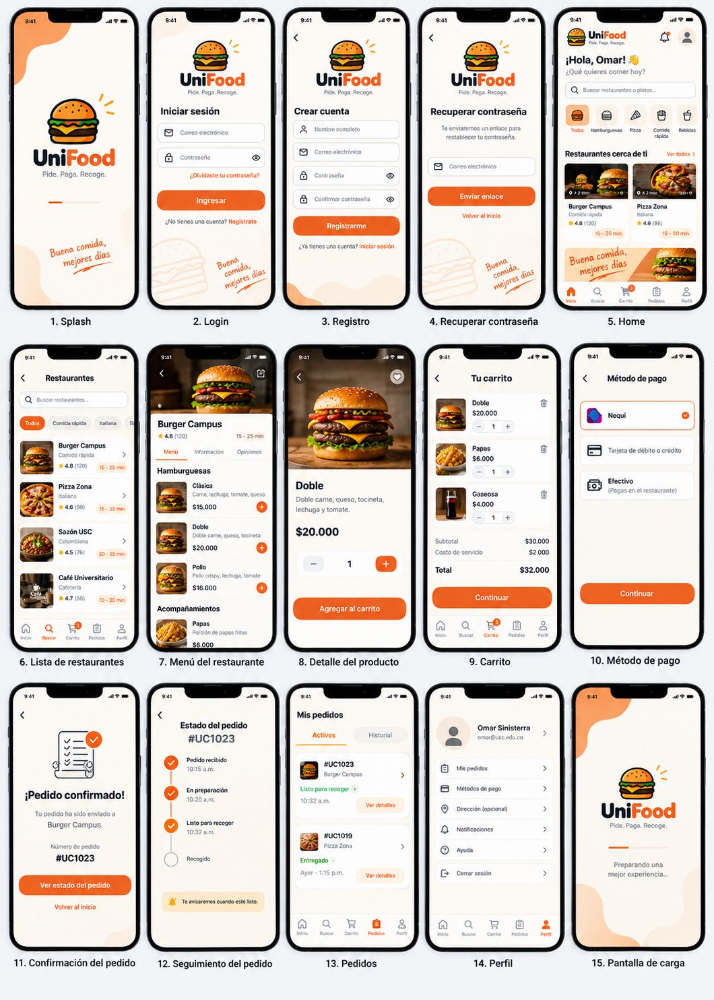

# UniFood
App Movil para pedir comida en el campus USC  |  React Native + Expo + Firebase

Proyecto de Desarrollo de Aplicaciones Móviles de la Universidad Santiago de Cali.

## Diseño y logo oficiales

El equipo adopta esta referencia como identidad visual de UniFood para los tres roles. Toda pantalla debe seguir su logo, colores, formas y estilo, según la [guía visual del equipo](DESIGN.md). La imagen guía la apariencia; los requisitos acordados determinan el comportamiento.



## Equipo

- Nahia Yesenia Montoya Sánchez
- Johan Sebastián Orejuela Mina
- Omar Sinisterra

### Reparto de trabajo

El trabajo se organiza en **26 requerimientos funcionales (RF)** dentro del [tablero del equipo](https://github.com/orgs/UniFood-USC/projects/1). Cada tarjeta reúne las tareas y los criterios necesarios para completar un requerimiento.

- **Omar Sinisterra — [Osinisterra](https://github.com/Osinisterra):** RF-01–RF-03, RF-07–RF-10, RF-12, RF-17, RF-21 y RF-26. Registro, acceso, recuperación, carrito, total, pagos simulados, identificador del pedido, notificaciones, usuarios y pedidos programados. También coordina la base común, seguridad e integración.
- **Nahia Yesenia Montoya Sánchez — [Nahia-24](https://github.com/Nahia-24):** RF-11, RF-13–RF-15, RF-18–RF-20 y RF-23. Seguimiento, historial, valoraciones, preparación, estados, ventas y reportes.
- **Johan Sebastián Orejuela Mina — [HAKAIEx](https://github.com/HAKAIEx):** RF-04–RF-06, RF-16, RF-22, RF-24 y RF-25. Listado y búsqueda de restaurantes, consulta y gestión del menú, administración de restaurantes, promociones y entrega al salón.

## Ejecutar

Requiere Docker Desktop abierto. Node, npm, Java, Expo, Firebase y todas las dependencias se ejecutan **dentro de Docker**. Los volúmenes `dependencies` y `functions-dependencies` aíslan ambos `node_modules` del equipo anfitrión. 

### 1. Preparar la terminal y las dependencias

En este Mac, el enlace habitual de Docker apunta al volumen antiguo del instalador. Estos comandos usan el Docker ya instalado, sin reinstalar nada:

```sh
export PATH="/Applications/Docker.app/Contents/Resources/bin:$PATH"
cd /Users/omarsinisterra/Documents/usc/Clases/AppMoviles/UniFood
```

Solo la primera vez, o si cambian los archivos de dependencias:

```sh
docker compose build
docker compose run --rm workspace sh -c 'npm ci && npm ci --prefix functions'
```

No hace falta repetir la instalación cada vez que abras el proyecto. Si los servicios están corriendo, detenlos con `docker compose down` antes de reinstalar dependencias.

### 2. Ver la app en el navegador del Mac

```sh
unset UNIFOOD_HOST
docker compose up -d workspace app
docker compose logs -f workspace
```

Espera a ver `All emulators ready`, pulsa **Ctrl+C** para salir de los logs (los servicios siguen activos) y carga los usuarios ficticios:

```sh
docker compose exec workspace npm run seed
```

Abre [UniFood](http://localhost:8081), [registro estudiantil](http://localhost:8081/register) o [panel de Firebase local](http://localhost:4000). El primer acceso puede tardar mientras Expo compila. Para ver el progreso: `docker compose logs -f app`.

### 3. Ver la app en Expo Go desde el teléfono

Necesitas **Expo Go para SDK 58** en el teléfono, y el Mac y el teléfono en la **misma red Wi-Fi**.

1. Busca la IP del Mac en Ajustes del Sistema → Wi-Fi → Detalles → TCP/IP y guárdala en el `.env` de la carpeta UniFood (no uses `localhost` ni `127.0.0.1`):

   ```sh
   UNIFOOD_HOST=192.168.1.50
   ```

2. Inicia los servicios:

   ```sh
   docker compose up -d workspace app
   ```

3. **Solo en iPhone y solo la primera vez:** inicia sesión en Expo con la misma cuenta que usas en Expo Go. Escribe usuario y contraseña cuando los pida:

   ```sh
   docker compose run --rm -e CI=0 app npx expo login --no-browser
   ```

4. Muestra el QR y escanéalo con Expo Go en Android o con la cámara en iPhone:

   ```sh
   docker compose logs -f app
   ```

5. **Solo la primera vez**, carga las cuentas y restaurantes de prueba:

   ```sh
   docker compose exec workspace npm run seed
   ```

Si cambias de red, actualiza la IP en `.env`, repite el paso 2 y recarga Expo Go. Usa esta opción solo en una red privada de confianza.

### Ver la base de datos y los usuarios registrados

Desde la carpeta UniFood, inicia los emuladores en Docker si no están encendidos:

```sh
docker compose up -d workspace
docker compose logs -f workspace
```

Espera el mensaje `All emulators ready`. Puedes salir de los logs con `Ctrl+C`; los contenedores siguen funcionando.

En el navegador, abre [Firebase Emulator Suite](http://localhost:4000):

- **[Authentication](http://localhost:4000/auth):** muestra las cuentas registradas, su correo y su UID (identificador único).
- **[Firestore](http://localhost:4000/firestore/default/data) → `users`:** abre el documento cuyo identificador coincide con el UID. Allí verás `name` (nombre), `email` (correo), `role` (rol) y `state` (estado). La contraseña no se guarda en este documento.

### Detener o volver al modo local

```sh
docker compose down
unset UNIFOOD_HOST
```

## Estructura

- `src/app/`: pantallas y navegación con Expo Router.
- `src/features/student/`: módulo Estudiante (RF-01 a RF-15), selección de bloque y salón para domicilio (RF-25), y selección de fecha y hora para pedidos programados (RF-26).
- `src/features/restaurant/`: módulo Restaurante (RF-16 a RF-20), configuración de cobertura y tarifa y gestión de entregas al salón (RF-25), y configuración de horarios y cupos y gestión de pedidos programados (RF-26).
- `src/features/admin/`: módulo Administrador (RF-21 a RF-24) y administración del catálogo de bloques y salones (RF-25).
- `src/components/`: componentes compartidos.
- `src/constants/`: colores y configuración visual.
- `src/types/`: tipos compartidos del dominio.

### Enviar correos reales con Brevo

El plan gratuito de Brevo permite 300 correos al día. Los correos llevan la marca de Brevo. El envío sale desde el emulador local, sin desplegar en Firebase.


   ```sh
   BREVO_API_KEY=tu-clave
   BREVO_SENDER_EMAIL=remitente-verificado@ejemplo.com
   RECOVERY_LINK_BASE=http://localhost:8081/reset
   ```

Para abrir el enlace desde el teléfono usa `RECOVERY_LINK_BASE=http://TU_IP_DEL_MAC:8081/reset`.
Recrea los servicios para que lean el `.env`:


## Verificaciones

Ejecuta estos comandos desde la carpeta UniFood. Todas las verificaciones corren en Docker, sin instalar herramientas en tu máquina; los contenedores temporales se eliminan al terminar.

```sh
# Pruebas generales: dominio, interfaz y navegación
docker compose run --rm workspace npm test

# Pruebas de integración con emuladores Firebase aislados
docker compose run --rm workspace npm run test:integration

# Lint: revisión de errores comunes y prácticas de código
docker compose run --rm workspace npm run lint

# TypeScript: comprobación de tipos sin generar archivos compilados
docker compose run --rm workspace npm run typecheck

# Expo: comprobación de compatibilidad de las dependencias con el SDK
docker compose run --rm workspace npx expo install --check
```

## Referencias

- [Expo SDK 58](https://docs.expo.dev/versions/v58.0.0/)
- [Expo Router](https://docs.expo.dev/router/installation/)
